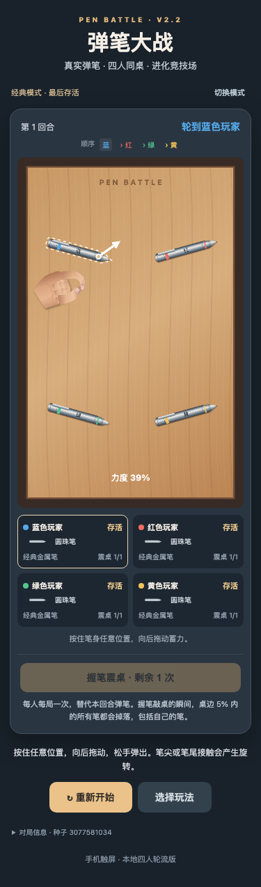
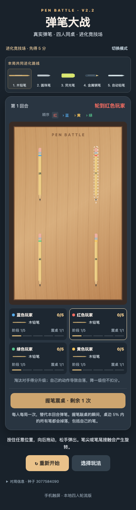
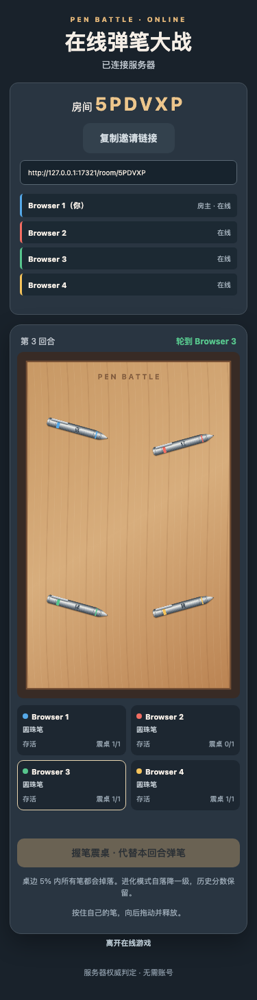

# Pen Battle

**Live Demo:** [https://pen-battle.onrender.com](https://pen-battle.onrender.com)

Pen Battle is a tabletop game for 2–4 players online, or four players on one screen. Flick your pen, knock the others off the wooden desk, and try to keep yours on it. Play on one screen or join friends online with a nickname and a six-character room code—no account needed.

## How to play

Press anywhere on your pen, drag backward, and release. A flick near the tip or tail creates rotation; a centered flick mostly slides. The hand animation reaches the chosen point before the impulse is applied.

- **Classic:** one metal ballpoint per player, permanent elimination, last pen standing wins.
- **Evolution Arena:** start with a wooden pencil and earn upgrades by eliminating opponents. Everyone shares one seeded progression through five pen types. Eliminated players respawn; five credited eliminations wins.
- **Self-elimination:** in Evolution, your own action knocking your pen off costs one upgrade stage, after earned upgrades. Your score stays unchanged. Stage zero cannot drop further.
- **Table Shake:** once per player per game, grip your pen and strike the desk instead of flicking. Pens whose centers are in the outer 5% edge zone fall—including your own.

Wooden pencils, mechanical pencils, ballpoints, highlighters, and fountain pens each have their own shape, mass, center of mass, inertia, and friction. Rendering and collisions share the same outlines. Rotation comes from rigid-body impulses, not a scripted spin.

## Screenshots

Actual local V2.2 matches, captured at a 375 px viewport:

  

## Run locally

Use Node **22.13 or newer within Node 22**; `.node-version` pins the deployment version. Install dependencies:

```sh
npm ci
```

Copy `.env.example` to `.env` if you need to change ports or allowed browser origins. In separate terminals:

```sh
npm run server:dev
npm run dev
```

Open `http://localhost:5173`. Vite proxies Socket.IO to the Node server on port 3001.

To run the production build locally:

```sh
npm run build
npm run server
```

Open `http://localhost:3001`. This one process serves the frontend, room links, `/health`, and Socket.IO.

## Online rooms

Choose **在线游戏**, create a room, and share its invitation link. Friends enter distinct nicknames and join by code. Before creating a room, the host selects Classic or Evolution and a capacity of 2, 3, or 4 players (default 4). Capacity is locked for that room, including rematches. Exactly that many connected players must ready up before the host can start. The lobby shows the occupied and total slots. The host can remove lobby players, which invalidates their old reconnect credentials.

Use different devices, browsers, or isolated profiles when testing multiple players. Tabs sharing browser storage represent the same saved identity; reclaiming a slot disconnects its previous controller. Refreshing a room link reclaims that slot using the private credential stored on the device.

For LAN play, bind `HOST=0.0.0.0` and add the exact LAN frontend origin to `FRONTEND_ORIGINS`. Other devices must use the host computer's LAN address, not `localhost`.

The server owns physics, actions, scores, upgrades, charges, respawns, and turns. Clients send validated action intents and interpolate snapshots. Rooms have no public directory. A disconnect pauses at the next safe turn boundary; after the 60-second grace period, the expired slot is removed and an interrupted match returns to the lobby. The room is deleted as soon as its last connected player or valid reconnect reservation is gone.

Click **离开房间** to leave explicitly. The client waits for server confirmation before returning to the menu and clearing its saved identity. Leaving immediately revokes that credential and frees the slot; the host migrates when necessary. A voluntary departure during Classic or Evolution cancels that match without awarding points and returns everyone else to the lobby. Empty rooms are deleted immediately, including after completed games. The production room limit remains five. See [V2.3.1 lifecycle details](docs/v2.3.1-room-cleanup.md).

## Tests and performance

```sh
npm test                    # physics/rules + real 2/3/4-client integration tests
npm run build               # frontend and typed Node server
npm run test:load            # isolated local 5/10/25-room benchmarks
SMOKE_URL=http://127.0.0.1:3001 SMOKE_PLAYERS=2 npm run test:browser -- --gameplay --lifecycle
# Requires Chrome + the production server above. Repeat with SMOKE_PLAYERS=3 and 4.
```

The load suite uses a separate server process and four independent Socket.IO clients per room. It measures server CPU/RSS, action acknowledgement latency, event-loop delay, reconnects, and snapshot consistency. See [measured results](docs/benchmarks/README.md) and [raw data](docs/benchmarks/v2.2-local.json). Local results are not a claim of equal capacity on Render Free.

## Render deployment

[`render.yaml`](render.yaml) defines **one Free Node Web Service**, from `main`, serving HTTP and WebSockets on the same origin. Build: `npm ci && npm run build`; start: `npm run server`; health check: `/health`. Render's public URL is used as the exact allowed browser origin.

The deployment template sets five rooms and 24 connections; local defaults are 25 rooms and 120 connections. Both are configurable. See [deployment details](docs/deployment.md).

The V2.2 release used four independent browser sessions to verify HTTPS/WSS, room links, joins, readiness, flicks, Table Shake, and reconnects on the public service. Additional four-client games verified scoring, upgrades, respawns, and the self-elimination penalty. See the [production verification record](docs/live-verification.md) for the checks performed and the checks not exercised. No production load test was run. See [V2.3 room sizes and verification](docs/v2.3-room-sizes.md) for the new release.

## Current limitations

- Rooms and reconnect identities live in one process's memory. Restarting or redeploying loses them; there is no database or multi-instance coordination.
- Free hosting can sleep, restart, or hit usage limits. A cold start can delay joining, and local benchmark results do not predict Internet latency or Free-tier CPU throttling.
- Physical mobile devices and WeChat need further testing. The hand is stylized Canvas artwork, not photorealistic.
- Adaptive substeps reduce tunneling but are not continuous collision detection at arbitrary injected speeds. A completely blocked respawn stays pending and retries.
- Removing a lobby player revokes that identity; without accounts it is not a permanent ban on a person creating a new identity.
